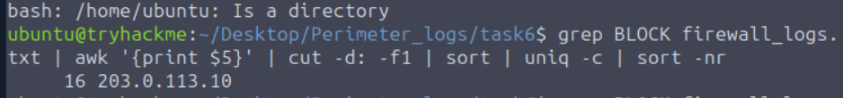
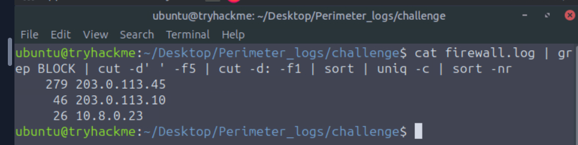
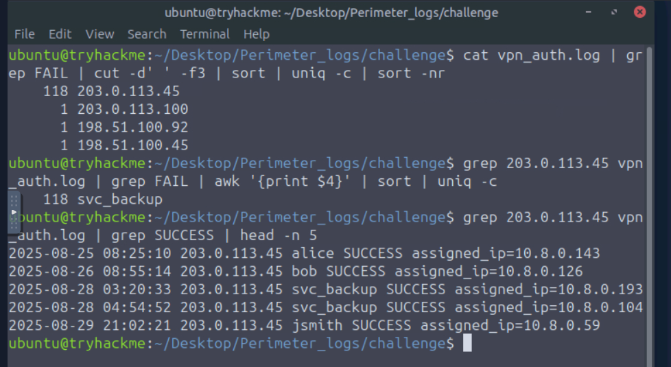
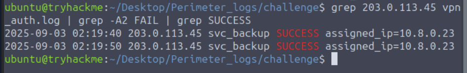
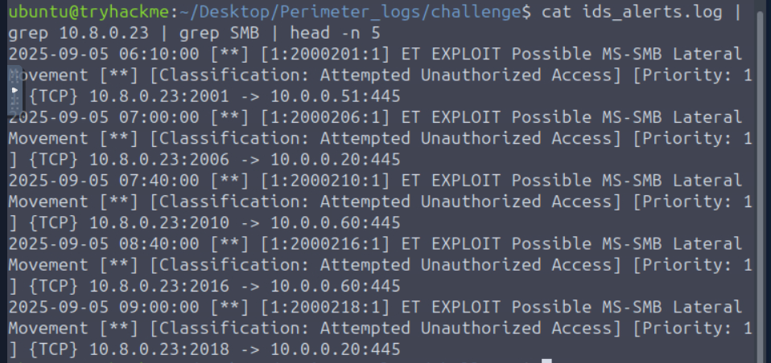
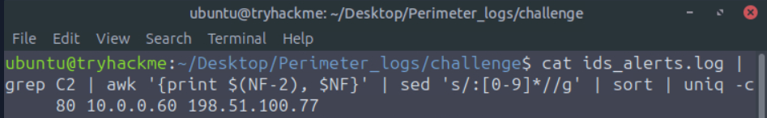
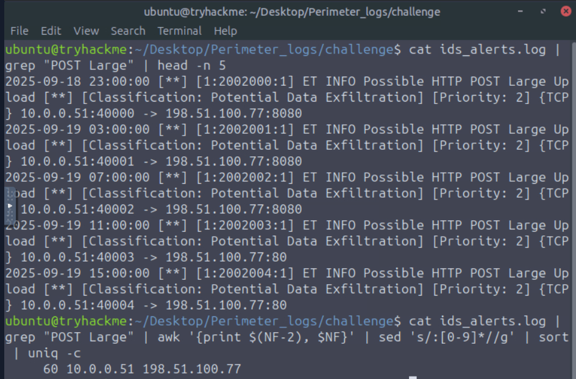

# 🛡️ Network Security Essentials: Perimeter Breach Investigation


> **Room:** [Network Security Essentials](https://tryhackme.com/room/networksecurityessentials)
> **Role played:** SOC Analyst (Tier 1)
> **Goal:** Investigate one month of perimeter logs and reconstruct how an attacker breached the network.

---

## 📌 Summary

Initech Corp, a financial services company, noticed abnormal traffic after deploying a new firewall and IDS. I analyzed **firewall, IDS and VPN logs** using Linux command-line tools and correlated them to reconstruct the **full attack chain**, from initial reconnaissance to data exfiltration.

**Key result:** The perimeter **was breached**. The attacker brute-forced a VPN service account, moved laterally over SMB, infected an internal workstation that beaconed to a C2 server, and exfiltrated data from an internal application server.

---

## 🧰 Skills Demonstrated

- Log analysis (firewall, IDS/WAF, VPN authentication)
- Threat detection: port scanning, brute force, lateral movement, C2 beaconing, exfiltration
- Linux CLI log parsing with `grep`, `awk`, `cut`, `sed`, `sort` and `uniq`
- Cross-source log correlation and incident timeline reconstruction
- MITRE ATT&CK mapping
- Writing incident findings and recommendations

---

## 🗂️ Log Sources

| File | Source | What it shows |
|---|---|---|
| `firewall.log` | Firewall | Allowed and blocked connections |
| `ids_alerts.log` | IDS | Signature-based alerts (scans, exploits, C2, exfiltration) |
| `vpn_auth.log` | VPN Gateway | Successful and failed remote logins |

---

## 🔍 Investigation

### Part 1: Warm-up (Recognizing Perimeter Attack Patterns)

Before the main investigation, I analyzed three small log files to recognize common attack patterns:

| Pattern | How I spotted it |
|---|---|
| **Port scan** | One external IP hitting 16 different ports on one internal host within seconds, all blocked |
| **Web attacks** | WAF blocked SQL Injection, XSS and Directory Traversal attempts, all from one IP |
| **VPN brute force** | 90 failed logins from a single IP trying common usernames (`admin`, `guest`, `user`) |

```bash
# Count blocked connections per source IP
grep BLOCK firewall_logs.txt | awk '{print $5}' | cut -d: -f1 | sort | uniq -c | sort -nr
```


---

### Part 2: Breach Investigation

#### 1️⃣ Reconnaissance

```bash
cat firewall.log | grep BLOCK | cut -d' ' -f5 | cut -d: -f1 | sort | uniq -c | sort -nr
```


One external IP stood out with **279 blocked connections**, far more than any other. Breaking its traffic down by destination showed it mainly targeted the **VPN Gateway** and the **Finance Server**, the organization's most critical assets.

#### 2️⃣ Credential Access: VPN Brute Force

```bash
cat vpn_auth.log | grep FAIL | cut -d' ' -f3 | sort | uniq -c | sort -nr
```


The same IP produced **118 failed VPN logins**, all against a single **service account**. Service accounts often have weak, rarely rotated passwords and no MFA, which makes them attractive targets.

#### 3️⃣ Initial Access

```bash
grep <attacker_ip> vpn_auth.log | grep -A2 FAIL | grep SUCCESS
```


Right after the failures, the login **succeeded** and the attacker was assigned an **internal VPN IP**. From this point, they were inside the network.

#### 4️⃣ Lateral Movement

```bash
cat ids_alerts.log | grep <vpn_ip> | grep SMB | head -n 5
```


From the VPN IP, the attacker connected to multiple internal hosts over **SSH, RDP and SMB**. The IDS raised Priority 1 **"MS-SMB Lateral Movement"** alerts.

#### 5️⃣ Command & Control

```bash
cat ids_alerts.log | grep C2 | awk '{print $(NF-2), $NF}' | sed 's/:[0-9]*//g' | sort | uniq -c
```


An internal **workstation** sent **80 beacons** to an external server on **port 4444**, at **exact 6-hour intervals**. Perfectly regular timing is a strong sign of malware beaconing rather than human activity.

#### 6️⃣ Data Exfiltration

```bash
cat ids_alerts.log | grep "POST Large" | awk '{print $(NF-2), $NF}' | sed 's/:[0-9]*//g' | sort | uniq -c
```


An internal **application server** made **60 large HTTP POST uploads** to the **same C2 IP** over ports 80/8080. Using common web ports helps exfiltration blend in with normal traffic.

---

## 🕒 Attack Timeline

```
Late Aug   Reconnaissance     External IP scans critical internal hosts (279 blocked)
Sep 03     Credential Access  118 failed VPN logins against a service account
Sep 03     Initial Access     Successful VPN login, internal IP assigned
Sep 05+    Lateral Movement   SMB / RDP / SSH to internal hosts
Sep 11+    Command & Control  Workstation beacons to C2 on port 4444 every 6h
Sep 18+    Exfiltration       App server uploads data to the C2 IP over HTTP
```

---

## 🎯 MITRE ATT&CK Mapping

| Tactic | Technique | Evidence |
|---|---|---|
| Reconnaissance | [T1595](https://attack.mitre.org/techniques/T1595/) Active Scanning | 279 blocked probes |
| Credential Access | [T1110](https://attack.mitre.org/techniques/T1110/) Brute Force | 118 failed VPN logins |
| Initial Access | [T1133](https://attack.mitre.org/techniques/T1133/) External Remote Services, [T1078](https://attack.mitre.org/techniques/T1078/) Valid Accounts | VPN login with compromised account |
| Lateral Movement | [T1021.002](https://attack.mitre.org/techniques/T1021/002/) SMB/Windows Admin Shares | IDS SMB exploit alerts on port 445 |
| Command and Control | [T1571](https://attack.mitre.org/techniques/T1571/) Non-Standard Port | Beaconing on port 4444 |
| Exfiltration | [T1041](https://attack.mitre.org/techniques/T1041/) Exfiltration Over C2 Channel | Large POSTs to the C2 IP |

---

## ✅ Recommendations

1. **Enforce MFA** on the VPN, especially for service accounts.
2. **Account lockout and alerting** after repeated failed logins; auto-block brute-force sources.
3. **Reset the compromised service account** and audit everything it accessed.
4. **Isolate the infected hosts** and perform endpoint forensics.
5. **Block attacker IPs** and **outbound traffic on port 4444**.
6. **Segment the network** so VPN clients cannot reach SMB/RDP/SSH on internal servers by default.
7. **Build SIEM correlation rules** linking VPN logins, IDS alerts and firewall events.

---

## 💡 Key Takeaways

- **No single log told the full story.** The breach only became clear after correlating the firewall, IDS and VPN logs together.
- **Patterns matter more than single events:** one source to many ports means scanning; many failures on one account means brute force; perfectly regular intervals mean beaconing.
- A **successful login after many failures** is one of the highest-value signals a SOC analyst can catch.

---

*Write-up by Massabe Ahmad · [TryHackMe Profile](https://tryhackme.com/p/YOUR_USERNAME) · [LinkedIn](https://linkedin.com/in/YOUR_PROFILE)*
